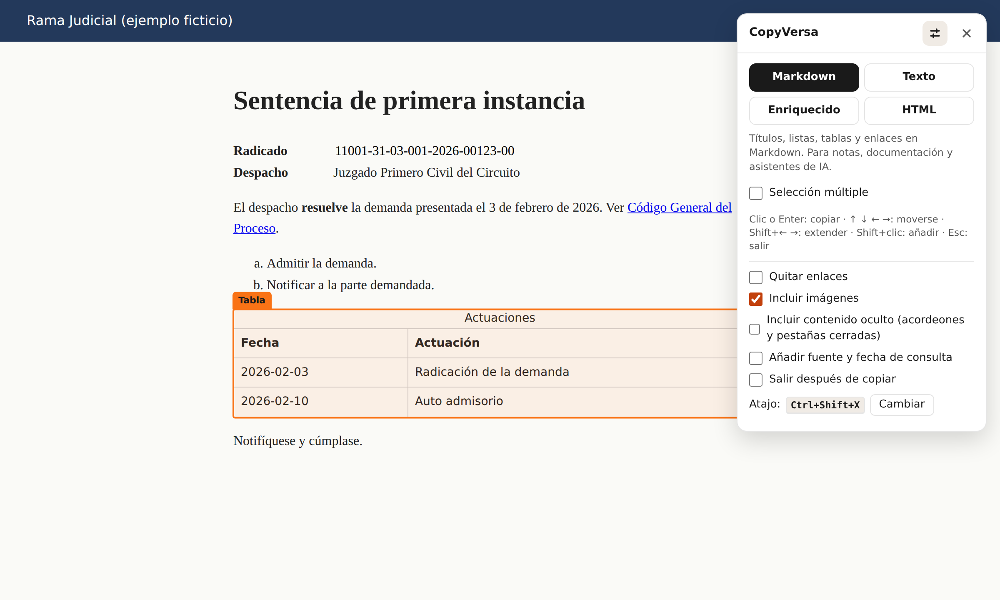

<h1 align="center">CopyVersa</h1>

<p align="center">
  Copia cualquier parte de una página web como Markdown, texto limpio o texto con formato para Word, sin arrastrar menús, estilos ni basura.
</p>

<p align="center">
  <a href="https://github.com/oddradiocircle/Copyversa/actions/workflows/ci.yml"></a>
  <a href="https://github.com/oddradiocircle/Copyversa/releases/latest"></a>
  <a href="LICENSE"></a>
</p>

<p align="center"><a href="README.en.md">English</a></p>



## Para qué sirve

Copiar desde la web suele salir mal. Al pegar en Word llegan colores, fuentes y tablas deformadas. Al pegar en un editor de texto se pierden los títulos, las listas y las columnas. Y los sistemas que muestran datos en campos de formulario, como muchos portales del Estado, no dejan seleccionar nada.

CopyVersa resuelve eso. Señalas un bloque de la página con el ratón, haces clic y el contenido queda en el portapapeles en el formato que elegiste, con su estructura intacta.

Nació para el trabajo diario de un abogado que transcribe providencias, normas y datos de expedientes, pero sirve a cualquiera que copie de la web para escribir, documentar o alimentar asistentes de inteligencia artificial (IA).

## Qué hace

- **Cuatro formatos.** Markdown (con tablas de GitHub), texto plano, texto enriquecido para Word, Google Docs o el correo, y HTML limpio.
- **Copia solo lo visible.** Descarta menús ocultos, scripts, estilos, botones y textos para lectores de pantalla.
- **Lee formularios.** Copia lo que muestran los campos, las listas desplegables y las casillas, también cuando son de solo lectura.
- **Respeta el formato.** Las negritas, cursivas, subrayados y alineaciones que la página aplica con CSS se convierten en formato real.
- **Tablas completas.** Convierte cualquier tabla de datos, aunque no tenga encabezados o tenga celdas combinadas. En texto plano separa las columnas con tabulaciones, para pegarlas en Excel.
- **Listas con literales.** Conserva los marcadores `a.`, `b.` o `i.`, `ii.` de las listas, para que las referencias como «literal b)» sigan teniendo sentido.
- **Cita la fuente.** Si lo activas, añade al final el título de la página, su dirección y la fecha de consulta.
- **Selección múltiple.** Reúne varios bloques de distintas partes de la página y los copia juntos, en el orden en que los elegiste.
- **Funciona donde otros fallan.** Funciona en páginas con políticas de seguridad estrictas y no altera la página ni sus estilos.

## Instalación

CopyVersa se instala de dos maneras. Las dos hacen lo mismo.

### Como userscript (Chrome, Edge, Firefox, Safari)

1. Instala un gestor de userscripts: [Tampermonkey](https://www.tampermonkey.net/) o [Violentmonkey](https://violentmonkey.github.io/).
2. Abre [**copyversa.user.js**](https://github.com/oddradiocircle/Copyversa/releases/latest/download/copyversa.user.js) y confirma la instalación.

El gestor busca actualizaciones automáticamente.

> En Chrome y Edge, Tampermonkey pide activar **Permitir scripts de usuario** en los detalles de la extensión (`chrome://extensions`). Sin ese permiso, ningún userscript funciona.

### Como extensión de Chrome o Edge

1. Descarga [**copyversa-extension.zip**](https://github.com/oddradiocircle/Copyversa/releases/latest/download/copyversa-extension.zip) y descomprímelo.
2. Abre `chrome://extensions` y activa el **Modo de desarrollador**.
3. Pulsa **Cargar descomprimida** y elige la carpeta descomprimida.

La extensión solo accede a la pestaña en la que la activas, en el momento en que la activas. No pide permiso para leer ningún sitio por adelantado.

## Uso

1. Pulsa **Ctrl+Shift+X** (en Mac, **Cmd+Shift+X** con la extensión). También puedes usar el botón de la extensión o el menú del gestor de userscripts.
2. Mueve el ratón: un recuadro naranja muestra qué bloque se copiará.
3. Haz clic para copiar.

| Acción                | Resultado                                                    |
| --------------------- | ------------------------------------------------------------ |
| Clic                  | Copia el bloque resaltado                                    |
| Flecha arriba / abajo | Amplía el recuadro al bloque que lo contiene, o vuelve atrás |
| Enter                 | Copia el bloque resaltado, o todos los elegidos              |
| Shift + clic          | Añade o quita un bloque de la selección múltiple             |
| Esc                   | Sale sin copiar                                              |

**Atajo con texto seleccionado.** Si seleccionas texto con el ratón y pulsas el atajo, CopyVersa copia esa selección de inmediato en el formato elegido.

### Formatos

| Formato         | Úsalo para                                                                                          |
| --------------- | --------------------------------------------------------------------------------------------------- |
| **Markdown**    | Notas, documentación, Obsidian, Notion, GitHub o asistentes de IA.                                  |
| **Texto**       | Transcribir sin marcas. Las tablas pegan bien en Excel.                                             |
| **Enriquecido** | Pegar en Word, Google Docs o el correo con negritas, listas y tablas, sin los estilos de la página. |
| **HTML**        | Reutilizar el contenido en otra página web.                                                         |

### Opciones

En el panel, el botón de opciones muestra:

- **Quitar enlaces:** deja solo el texto de los enlaces.
- **Incluir imágenes:** conserva o descarta las imágenes.
- **Incluir contenido oculto:** copia también los acordeones y las pestañas cerradas del bloque. Solo incluye las secciones que la página marca como plegables; los menús, duplicados y avisos ocultos quedan fuera. Viene apagada.
- **Añadir fuente y fecha de consulta:** agrega, por ejemplo, `Fuente: Ley 1564 de 2012. https://… Consultado el 21 de octubre de 2026.`
- **Salir después de copiar:** cierra CopyVersa después de cada copia.
- **Atajo:** en el userscript puedes cambiarlo. En la extensión se cambia en `chrome://extensions/shortcuts`.

CopyVersa recuerda tus preferencias.

## Privacidad

CopyVersa no envía nada a ningún servidor, no usa analítica y no carga código externo. Todo ocurre en tu navegador. El contenido solo va a tu portapapeles. Los detalles están en [PRIVACY.md](PRIVACY.md).

## Límites conocidos

- Funciona dentro de los marcos (`iframe`) del mismo sitio. Los marcos de otros dominios quedan fuera por seguridad del navegador: en el userscript, haz clic dentro del marco y pulsa el atajo ahí.
- No copia texto dibujado en lienzos (`canvas`) ni dentro de visores de PDF.
- El contenido oculto, como pestañas o acordeones cerrados, solo se copia con la opción **Incluir contenido oculto**. Si la página carga ese contenido solo al abrirlo, ábrelo antes de copiar.

## Desarrollo

Necesitas [Node.js](https://nodejs.org/) 22 o superior.

```bash
npm install
npm run build       # genera dist/copyversa.user.js y dist/extension/
npm test            # pruebas unitarias
npm run test:e2e    # pruebas en Chromium real (requiere npx playwright install chromium)
npm run check       # todo lo que revisa la integración continua
```

La guía para contribuir está en [CONTRIBUTING.md](CONTRIBUTING.md) y los cambios de cada versión, en [CHANGELOG.md](CHANGELOG.md).

## Licencia

[MIT](LICENSE) © Daniel Gómez-Padilla. Incluye [Turndown](https://github.com/mixmark-io/turndown) (MIT).
